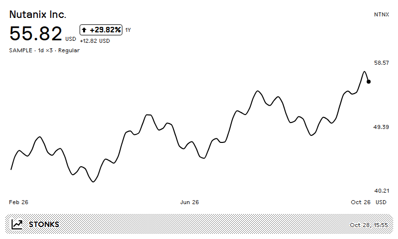
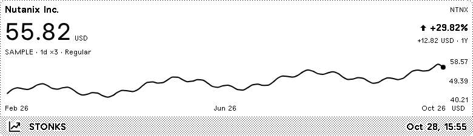
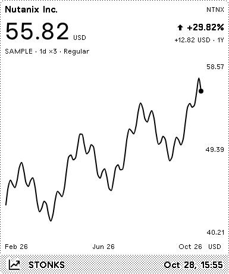
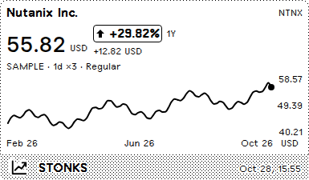
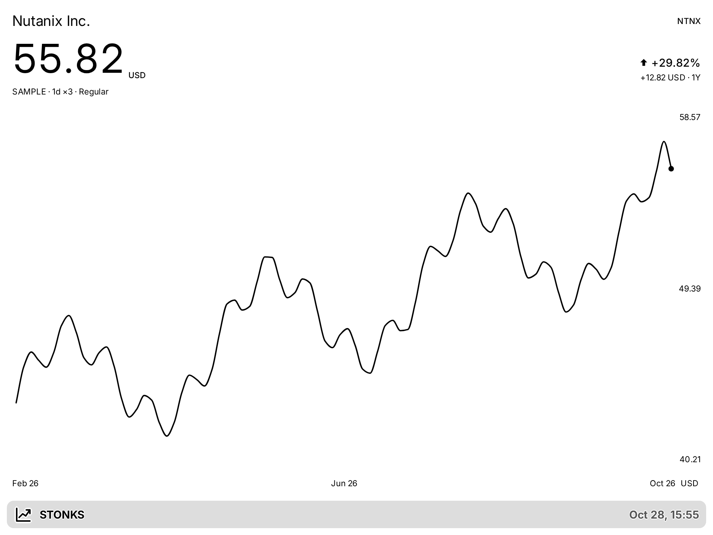
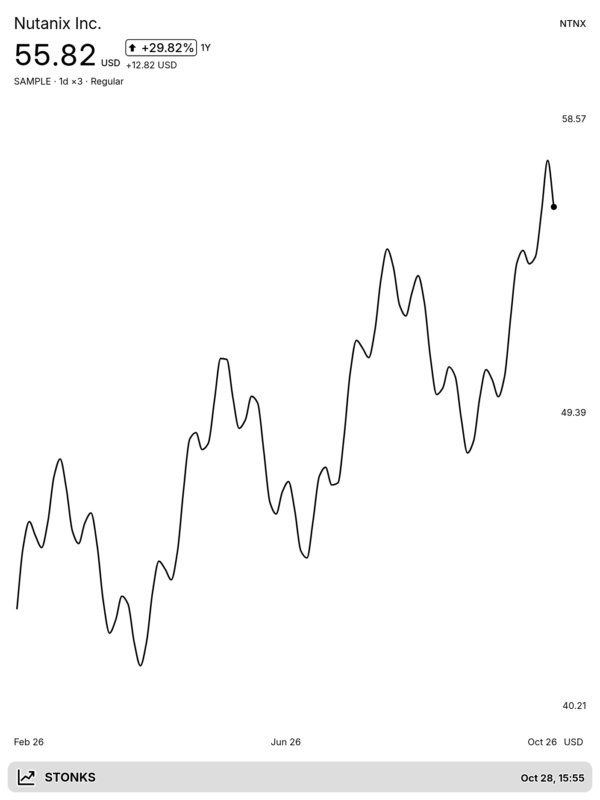
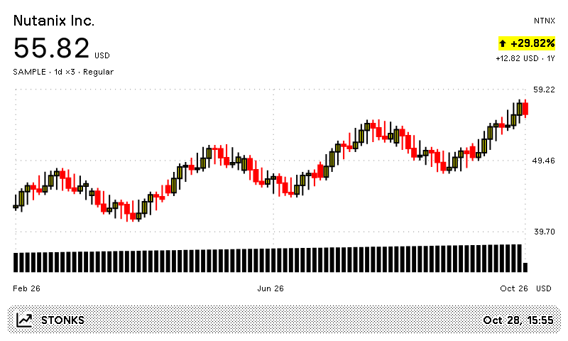

# STONKS

Yahoo Finance prices and charts for TRMNL, rendered with Framework 3.4.3 and inline SVG.

## Icon

<div align="center">
  
</div>

The original [icon.svg](media/icon.svg) shows a rising stock line on a transparent background, using the same orange (`#E76F55`) as HTTP Pets, TMB and TRMNLGotchi. It is included under the project's [MIT license](../LICENSE).

## Previews

Synthetic sample prices rendered from the actual templates with Framework 3.4.3.

| Full View | Half Horizontal View |
| --- | --- |
|  |  |

| Half Vertical View | Quadrant View |
| --- | --- |
|  |  |

| TRMNL X Landscape | TRMNL X Portrait |
| --- | --- |
|  |  |



## Setup

Create a Private Plugin with **Polling**, **Node** Serverless and Framework **3.4.3**. Use the polling URL and headers from [settings.yml](src/settings.yml), including the User-Agent header. Keep normal screen padding.

Copy the form and plugin settings from [settings.yml](src/settings.yml). Paste [shared.liquid](src/shared.liquid) into Shared, each layout into its matching markup tab, and the complete [transform.js](src/transform.js) into Serverless. Save, refresh and add the plugin to your playlist.

Upload [media/icon.svg](media/icon.svg) in the plugin's icon field. MCP source imports do not upload icon assets.

For automatic publishing, add `TRMNL_API_KEY` and `TRMNL_PLUGIN_SETTING_ID` as GitHub Actions repository secrets. The plugin setting ID is the number in its `/plugin_settings/<ID>/edit` URL. The **Publish to TRMNL** workflow runs the tests and device previews before deploying source or media changes on `main`; it can also run manually.

The existing private installation can also be updated through TRMNL MCP. Keep MCP credentials in the client's private configuration.

## Settings

| Control | Options |
| --- | --- |
| Symbols | One or more comma-separated Yahoo Finance symbols, plain or URL-encoded |
| Currency | `NATIVE`, available fiat pairs, BTC or ETH |
| Date range | 1D/minute, 1M/30 minutes, 3M/hour, 1Y/day, 5Y/week, all time/month |
| Chart type | Line, OHLC bars or candles |
| Line style and width | Straight, stepped or smooth; 1–5 px strokes |
| Grid, volume, baseline | Show/hide; volume requires provider data |
| Extended hours | Available intraday pre/post-market bars |
| Language | English, German, French, Spanish, Italian or Polish |
| Heading and label size | Small/normal/large heading; 8–16 px supporting text, default 12 px |
| Decimal places | Automatic, 0, 2, 4 or 6 decimals |

Examples: `NTNX`, `VWCE.DE`, `%5ESTOXX50E`, `BTC-USD`, `EURUSD=X`. Some instruments lack particular ranges, FX pairs, OHLC or volume.

For rotation, enter a list such as `NTNX,AAPL,NVDA`. Each data refresh polls one symbol, in order, wrapping to the first after the last. Spaces around entries, empty entries and repeated entries are ignored. One symbol retains the existing behavior. There is no plugin-imposed ticker count limit; normal TRMNL form and runtime limits still apply. Currency, range and chart settings apply to every symbol.

Changing the list or clearing Saved State restarts at the first entry. Rotation follows data refreshes, rather than every playlist appearance or layout render. The refresh interval is the minimum time between eligible updates; actual updates follow TRMNL's device/playlist cadence.

## Templates

- **shared.liquid:** shared UI preparation, palette styles and reusable heading, quote, status, chart and footer components.
- **full.liquid:** prominent price and a full-size chart.
- **half_horizontal.liquid:** short layout with a cap on the largest quote size.
- **half_vertical.liquid:** stacked quote and return above the chart.
- **quadrant.liquid:** compact typography for the smallest slot.
- **transform.js:** Yahoo response validation, FX requests, conversion, saved-state recovery, chart coordinates and exact numeric/date formatting. No runtime packages or browser scripts.

OG and X use black arrows and hollow rising/filled falling candles. B/W/R/Y adds yellow gains and red losses; full-color palettes use green/red. The main price stays black. The return indicator follows the selected baseline, while each candle follows its own open-to-close move.

On OG full screen, the normal company name uses the native 21 px title and the price remains 38 px. Labels and supporting text default to 12 px, matching TRMNL's small pixel font. Smaller slots retain compact headings, and X uses the framework's device scaling.

## Data and saved state

TRMNL polls Yahoo directly. Serverless validates and compacts the response and requests FX when needed. If a poll fails (including HTTP 429), TRMNL passes an empty payload to Serverless. A matching saved snapshot is displayed immediately with **STALE DATA** and **Yahoo polling failed**, retaining the original price, chart and market timestamp without another Yahoo request. The failed poll's HTTP status is not available in that payload; check TRMNL's logs for the specific error.

Serverless never retries the stock request, even on a fresh installation. A selection without a valid snapshot shows unavailable data. Native-currency charts need only TRMNL's stock poll. Conversion adds one request per required FX pair (up to two for conversion from non-USD into BTC/ETH), with no retries and a shared 3.8-second deadline. Each FX response is limited to 2 MiB. FX failures (including HTTP 429), invalid responses and quote regressions also fall back to matching saved data. Source or FX quotes older than seven days are also stale; this is not an exchange calendar. A successful, current response clears the stale flag.

Saved-state fallback does not suppress TRMNL's polling-health warnings or control its transport retries: [TRMNL can retry a timed-out poll, and repeated polling failures can stop refreshes](https://help.trmnl.com/en/articles/17434705-plugin-strategies). After Yahoo recovers, use **Reset Health** if TRMNL has stopped the plugin. Avoid repeated Force Refresh requests while rate-limited. Keep Saved State intact so the fallback remains available.

Rotation keeps only the latest successful chart plus a small cursor in Saved State, not a chart for every ticker or a copy of the list. A failed selection can reuse that chart only when its symbol, currency, range and session match. Otherwise it shows unavailable data, retaining the latest good chart for possible later reuse. A successful HTTP response advances rotation even if its chart is invalid or conversion fails. An empty response holds the position. TRMNL skips state writes after failed polls, so HTTP errors such as 429 or an invalid symbol's 404 keep the same ticker until polling succeeds or the list changes. Serverless never tries another stock to bypass a failure; existing FX requests remain available for conversion.

Saved State is limited to 8,192 bytes. Long histories are grouped into OHLCV buckets; `×N` shows the grouping factor. Market timestamps retain their exact seconds. Changing symbol, currency, range or session prevents reuse of a different selection's chart. Display changes can redraw saved data during an outage. Do not clear Saved State routinely.

30-minute charts request 15-minute data and aggregate OHLCV locally, including FX series, to avoid Yahoo's unreliable 30-minute interval. A separate live daily row replaces the earlier snapshot; separate weekly/monthly live rows are folded into their candle. Yahoo error descriptions are shown when available.

Prices and returns use unadjusted closes, excluding reinvested dividends. Native-currency 1D returns use the previous close when available; other returns use the first close. Currency conversion aligns historical rates at or before each asset bar. Converted OHLC values are estimates, labelled **FX estimate**; converted 1D returns start at the first aligned bar, labelled **from first bar**. Unsupported or stale FX pairs are rejected. Market times use the exchange timezone.

## Development

[.trmnlp.yml](.trmnlp.yml) supplies a fixed, clearly labelled synthetic quote with Serverless disabled for local preview. It contains no credentials or live market history. Use `trmnlp serve` from this directory for native local rendering.

For the adapter tests and full device matrix, run from the repository root with Node 20+:

```sh
npm install --no-save --package-lock=false --ignore-scripts liquidjs@10.30.1 playwright-core@1.64.1 yaml@2.9.1
node --test TRMNL/check.cjs
npx playwright-core install --with-deps chromium
TRMNL_BROWSER=chromium node scripts/preview.cjs
```

These packages are development tools only. The test suite covers market data, FX, saved-state isolation, failures, chart geometry, locales and Liquid rendering. GitHub Actions runs the same checks on `main` pushes and pull requests.

Open `dist/preview/index.html` for 704 sample previews: four device profiles, both orientations, all four layouts and twenty-two data/chart scenarios. The script uses the pinned framework and actual fonts, checks bounds, overlapping text, chart endpoints and palette colors, and caches assets under `.cache/`. Native B/W/R/Y server thumbnails are grayscale; physical ink and dithering require a device check.

The repository previews are lossless WebP exports of those PNGs. To update one, keep the sample label and existing media filenames:

```sh
magick dist/preview/og-landscape-full-fresh.png -define webp:lossless=true TRMNL/media/preview_full.webp
```

## Provider limitations

Yahoo's chart endpoint has community documentation and implementations; see the [API references in the project README](../README.md). The endpoint can fail or change, and instrument coverage, history and FX pairs vary. Review [Yahoo's terms](https://legal.yahoo.com/us/en/yahoo/terms/otos/index.html) for your intended use.

Stock logos are not included in the chart response used by STONKS. Yahoo exposes logo fields on a separate [quote endpoint](https://github.com/gadicc/yahoo-finance2/blob/634e594b30ce962d8b85f92fc1657d9a30a27398/src/modules/quote.ts); the plugin does not add a second request or authentication flow for logos.

[TRMNL Shared templates](https://help.trmnl.com/en/articles/13216853-reusing-markup-with-shared) · [Charts](https://trmnl.com/framework/docs/3.4/chart) · [Serverless](https://help.trmnl.com/en/articles/14130649-serverless) · [Saved State](https://help.trmnl.com/en/articles/16777795-saved-state)
